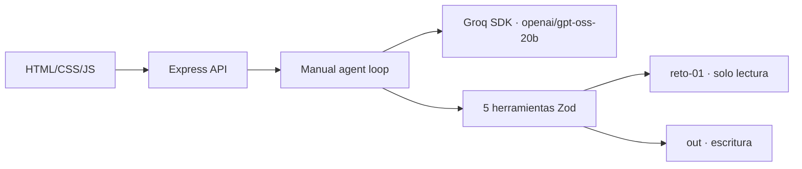

# Solución — Agente Registro como Proveedor

## 1. Problema
Automatiza la preparación trazable de registros de proveedor para que el equipo administrativo no transcriba repetidamente datos existentes.

## 2. Arquitectura

El comportamiento vive en `agent/prompt.md`, conocimiento en `src/knowledge/registro-proveedor.md` y ejecución en `src/tools/proveedor.ts`.

## 3. Ciclo del agente
El adaptador propio expone `enviar`; el loop manual conserva mensajes, ejecuta llamadas tipadas, devuelve resultados JSON al modelo y limita iteraciones, tokens y timeout. El servidor registra herramientas globalmente y por caso. La confirmación se guarda con caso y posición del turno; únicamente el siguiente turno explícitamente confirmatorio habilita la simulación, aunque el modelo envíe `confirmado: true`.

## 4. Modelo
Se usa el SDK oficial `groq-sdk` con `openai/gpt-oss-20b` por defecto y `GROQ_API_KEY` en el backend. El costo depende de las condiciones vigentes de Groq; el tope de tokens por sesión limita el uso. El demo y las pruebas no consumen modelo.

## 5. Portal web
En producción usaría navegador controlado/RPA aislado con selectores auditables. CAPTCHA, MFA y cambios de interfaz obligan intervención humana. Credenciales viven en un vault, nunca en prompt, repositorio ni logs; el humano ingresa credenciales y hace clic final en Enviar. El agente prepara valores y valida campos, pero no ejecuta la carga final.

## 6. Decisiones y trade-offs
1. Archivos locales y memoria en lugar de base de datos: suficientes para el alcance; producción requiere persistencia y auditoría centralizada.
2. PDF reproducido con `pdf-lib` en vez de AcroForm: satisface la plantilla declarativa sin depender de PDFs binarios no entregados.
3. Mapeo determinista por glosario, no por inferencia LLM: evita inventar datos; sacrifica reconocimiento de etiquetas no catalogadas.
4. HTML plano en vez de framework: arranque pequeño y superficie accesible; una app grande podría beneficiarse de componentes.

## 7. Supuestos
Las fechas de vigencia se comparan con fecha de ejecución, el maestro es fuente autorizada y los nombres de carpetas son los IDs de caso. Los portales usan `plantilla-campos.json` como lista de valores.

## 8. Cobertura
| HU | Estado | Alcance |
|---|---|---|
| HU-1 | Hecho | Solicitud, plantilla, país, formato y soportes. |
| HU-2 | Hecho | Glosario, trazabilidad, faltantes y regla país. |
| HU-3 | Hecho | XLSX, PDF y Markdown de portal. |
| HU-4 | Hecho | Paquete, checklist, borrador y bloqueo. |
| HU-5 | Hecho | JSON de error, errores de plantilla/caso y recuperación. |

Para producción faltan autenticación, almacenamiento seguro, plantillas binarias originales, observabilidad centralizada y revisión legal.

## 9. Uso de IA
Se utilizó PERXIA para construir, revisar tipos, diseñar tests y validar el resultado. Se descartó cualquier sugerencia de inferir valores ausentes o exponer secretos; los valores salen exclusivamente de herramientas y fixtures.

## 10. Riesgos
Riesgos: maestro desactualizado, plantillas reales no estructuradas, alucinación del modelo y exposición de soportes. Mitigación: dueño de datos, extracción revisable, herramientas como fuente exclusiva, logs con redacción de secretos, controles de acceso y aprobación humana. Link de prueba: **pendiente/local** (`http://localhost:3000`).
